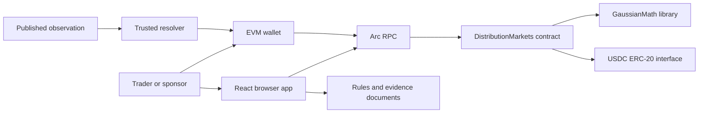

# Architecture — DAZZ Markets on Arc

Status: implemented architecture; public Arc Testnet deployed/verified with completed settlement/refund acceptance; mainnet funding/publication pending. Updated: 10 October 2026.

## System boundary

The blockchain stores market state, receipts, permissions, collateral accounting, and final outcomes. The browser edits and displays forecasts, signs wallet transactions, and reads chain state. A human resolver obtains an observation from the market's declared source and submits it with evidence.

## Stack and components

| Component | Proposed choice | Responsibility |
| --- | --- | --- |
| Web app | React, TypeScript, Vite | Market pages, editor, positions, operator controls. |
| Chain access | viem | Reads, simulation, wallet calls, and receipt tracking. |
| Charts | SVG | Probability density, interval highlights, and P&L. |
| Contracts | Solidity, Arc Foundry | Market lifecycle and escrow. |
| Gaussian math | One reviewed fixed-point library plus pure evaluator | Exponential/square root and deterministic integer curve values. |
| Reference | High-precision Python model | Independent fixtures and numerical error analysis. |
| Storage | Contract records plus immutable metadata | Authoritative financial state and committed market rules. |

Compatibility checks passed for the pinned toolchain: Solidity 0.8.30, PRBMath 4.1.0, OpenZeppelin 5.4.0, Arc Foundry v0.8.0-2, Node, React, Vite, and viem versions are pinned in the manifests, lockfile, and evidence. Do not add a custom backend, factory, upgrade proxy, or token standard to this MVP.

## Network configuration

Initial configuration follows the [plan's Arc integration](plan.md): chain ID `5042002`, RPC `https://rpc.testnet.arc.io`, explorer `https://explorer.testnet.arc.io`, USDC interface `0x3600000000000000000000000000000000000000`.

Application amounts use integer micro-USDC, six decimals. Native fee estimates use 18-decimal USDC units. Both refer to the same underlying balance. Configuration must validate RPC chain ID and token decimals before transactions. Values are documentation snapshots, not live connectivity evidence; recheck before deployment using [Arc connection docs](https://docs.arc.io/arc/references/connect-to-arc).

## Contract model

Deploy one non-upgradeable `DistributionMarkets` contract. Pure `GaussianMath` code computes curve evaluations. Contract immutable configuration includes the token and market-creation operator.

Each market records sponsor, resolver, rules commitment/URI, units/normalization, backing `b`, norm parameter `k`, initial/current curves, numeric bounds, close and resolution times, nonce, terminal status/outcome, deposits/paid counters, and sponsor claim status.

Each receipt records owner, market ID, old/new curves, deposit, and claimed flag. IDs are monotonic. No receipt can be transferred, merged, or modified. Store no per-outcome token array.

Represent coordinates with a single documented fixed-point scale and collateral with micro-USDC. Store creation bounds and normalization immutably. The resolver submits the canonical normalized outcome; conversion from source units follows the committed rules and nearest-step rounding, with exact halves away from zero. The contract validates its encoding and supported range; correctness against source evidence remains trusted. See [reference/numeric-spec.md](reference/numeric-spec.md). The frontend reads these bounds and must not choose its own convention.

## Lifecycle

Persistent status is `Active`, `Resolved`, or `Cancelled`. `Closed` is a derived display state when an active market has reached `closeAt`.

- Trade requires active status and `now < closeAt`.
- Resolution requires active status and `closeAt <= now < resolveBy`.
- Expiry cancellation requires active status and `now >= resolveBy`.
- Claims require resolved or cancelled status and unclaimed ownership.

No keeper is needed to stop trading. Resolution and cancellation are irreversible and mutually exclusive.

## Trade sequence

1. Read the market and nonce from one consistent block snapshot.
2. Build the proposed curve and display approximate curves plus fixed deposit `b`.
3. Check wallet chain, allowance, deposit, and gas headroom.
4. Approve the required amount if necessary; await and reconcile its receipt.
5. Re-read state, refresh stale previews, and simulate `trade`.
6. Submit curve, expected nonce, maximum deposit, and transaction deadline.
7. Onchain validate every input, pull `b`, store old/new receipt state, update curve/nonce, and emit `CurveChanged` atomically.
8. Confirm transaction and receipt ID from the dapp event; reload authoritative records.

## Settlement and escrow

Use one deterministic integer evaluator `F(curve, outcome)` bounded to `[0,b]`. Trader payout is `b + F(new) - F(old)`. Sponsor payout is `b + F(initial) - F(final)`.

The chain of stored curves telescopes, so the sum of integer claims equals total recorded deposits. Track `deposited` and `paid` per market. Maintain an aggregate outstanding-liability counter if needed for a constant-time contract-wide balance check; never use token balance as the source of claim ownership.

Set claim flags and decrement liability before token transfers, under reentrancy protection. A failed transfer must revert the entire claim. Use safe ERC-20 calls; no native sends, `SELFDESTRUCT`, or admin withdrawal of user liabilities. Direct donations do not alter market backing or payouts. The implemented contract also checks that each market's outcome interval contains at least one admissible outcome-step multiple.

## Reads, events, and recovery

Public-testnet wallet funding uses a native dialog in the header. It copies only the connected public address and links to Circle's official faucet; CAPTCHA and token requests happen on Circle's page. The panel reads native USDC through the existing public client, bounds refresh time, and invalidates results on account changes or close. It never signs or assumes a faucet request succeeded. No funding backend or browser API key is required. Mainnet and local deployments omit this action.

Expose enough getters for market details, receipts, and claim previews. Events carry IDs, owner, nonce, and curve/deposit details sufficient to reconstruct discovery and history. Paginate log queries from the deployment block and deduplicate by transaction hash/log index. Re-read records before displaying actionable claims.

Cache public records locally; cache is disposable. Browser local storage may retain transaction hash, chain ID, wallet, and intended action for reconciliation, never private keys. “Unknown” transactions must be checked by hash and contract events before another submission is suggested.

Forecast review, approval preparation, forecast preparation, and post-approval checks each bound read/simulation work to 35 seconds. A late preparation result cannot start signing. The workspace owns a synchronous send lock and separate wallet/receipt stages. A 30-second wallet wait only advises the user to open their wallet; it keeps the request blocked until a hash or error arrives. Receipt timeout preserves unknown state, with its hash and reconciliation action visible in the editor. Confirmed submission returns before background discovery refresh. Prepared gas with a 20% reserve and estimated fees are passed to the wallet; failures remain local to the forecast action across background reads.

Index dapp events rather than deriving receipts from token transfers. Observe [Arc runtime differences](https://docs.arc.io/arc/references/evm-differences.md), including transfer restrictions and receipt behavior.

## Rules and evidence availability

Use a deterministic serialized rules document with a stored hash, plus URI. Frontend verifies the hash before presenting it as committed rules. The hash proves integrity, not truth or availability. Preserve a bundled copy of demo rules and durable evidence; show an unavailable/mismatched metadata state rather than invented text.

## Build structure and deployment

Follow the directory layout in [plan.md](plan.md). Generate browser ABI/address exports from artifacts and the chosen deployment manifest. Public testnet is deployed and verified; mainnet and local deployment use separate manifests. Manifests record actual receipts, chain ID, operator, compiler settings, source fingerprint and verification link. Browser transaction history is isolated by chain, RPC and contract. Public real-market rules are self-contained base64 canonical JSON whose exact bytes must match the stored hash. Signing material is Windows DPAPI protected in ignored `.private/` and never exported to browser code.

CI runs reference fixture checks, contract tests/invariants on Arc's runtime, TypeScript checks, and web build. Actual testnet settlement and refund evidence is complete; mainnet scripts validate current source and evidence fingerprints first. [Rules.md](Rules.md) is the normative behavioral specification; [Phases.md](Phases.md) records the gate sequence.
